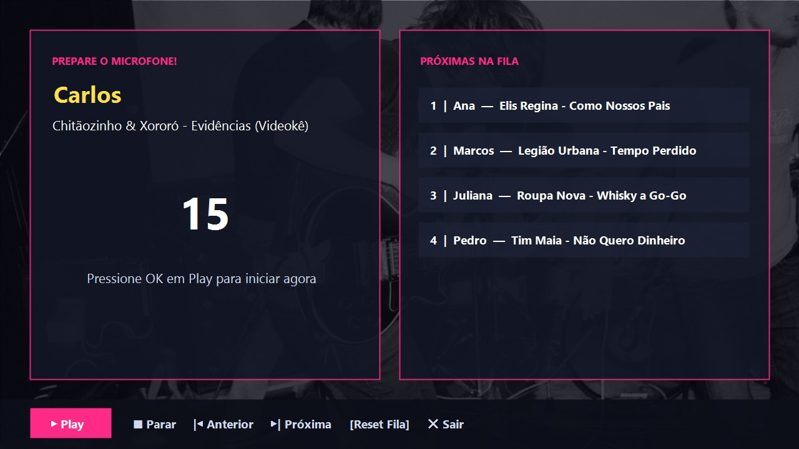
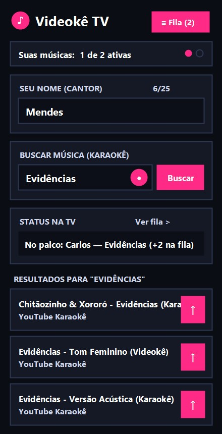

# Videokê TV — Karaokê para Smart TV Samsung (Tizen 6.5) com Fila Mobile via QR Code


Estação completa de **Videokê / Karaokê** desenvolvida para Smart TVs Samsung com Tizen (construída e testada em uma **Samsung UN65BU8000 · Tizen 6.5**) e integrada ao launcher [**lilauncher**](https://github.com/mendes79/lilauncher).

A TV executa o player em tela cheia (1080p) com transição automatizada de 15 segundos entre cantores, enquanto os convidados escolhem as músicas pelos próprios celulares apontando a câmera para o **QR Code** na tela — sem necessidade de instalar aplicativos ou criar contas.

---

## Demonstração Visual

| Tela de Contagem e Fila na TV (1080p) | Web App Mobile — Alta Visibilidade (40+) |
| :---: | :---: |
|  |  |

---

## Principais Funcionalidades

### Na Smart TV (`videoke-app/` · Pacote Tizen `.wgt` `lilvideoke.Videoke`)
- **Pareamento Instantâneo via QR Code**: Tela de espera (`IDLE`) com QR Code gerado localmente (`qrcode.min.js`) e **Mini QR Code flutuante** no canto inferior esquerdo durante a reprodução dos vídeos para quem chegar no meio da sessão.
- **Tela de Contagem Regressiva de 15s em 2 Colunas**:
  - **Coluna Esquerda**: Exibe o nome do próximo cantor, título da música e contador regressivo de 15 segundos.
  - **Coluna Direita**: Exibe a lista numerada (`1, 2, 3...`) das próximas músicas aguardando na fila em tempo real.
  - **13 Wallpapers Full HD Sorteados Aleatoriamente**: A cada transição, um dos 13 papéis de parede (`1920x1080`, otimizados em `videoke-app/img/wallpapers/wp_01..13.jpg`) é sorteado sem repetição consecutiva.
- **Barra de Menu e Controle Remoto Samsung**:
  - Botão único dinâmico **`▶ Play` / `❚❚ Pausa`**: Recebe foco automático como `▶ Play` ao abrir a contagem regressiva de 15s (basta apertar `OK` no controle remoto para iniciar a música imediatamente), alterna para `❚❚ Pausa` quando o vídeo começa e volta para `▶ Play` quando pausado.
  - **Timeout Inteligente de Pausa (60s)**: Se o vídeo ficar pausado por 60 segundos, avança automaticamente para a próxima música da fila, exibindo aviso visual na tela e emitindo um bip sonoro discreto (Web Audio API) nos últimos 10 segundos.
  - Controles adicionais: `■ Parar` (interrompe e volta ao QR Code), `|◀ Anterior` (reinicia a música atual), `▶| Próxima` (pula para a próxima da fila), `🗑 Reset Fila` (limpa toda a fila no Firebase) e `✕ Sair`.
- **Ponte HTTPS para YouTube IFrame API (`yt-bridge.html`)**: Contorna a restrição de origem `file://` de aplicativos empacotados no Tizen carregando o player através de uma ponte HTTPS hospedada no Firebase Hosting (`https://videoke-tv.web.app/yt-bridge.html`) controlada via `postMessage`.

### Nos Smartphones (`videoke-mobile/` · Firebase Hosting SPA)
- **Design de Alta Visibilidade (Conforto Visual 40+)**: Fontes ampliadas (`18px–26px`), alto contraste e botões ergonômicos para leitura confortável sem óculos em ambientes de festa.
- **Busca por Texto e Comando de Voz**: Integração com a **YouTube Data API v3** (`videoEmbeddable=true`) e reconhecimento de voz via **Web Speech API** (`webkitSpeechRecognition`) alinhados na mesma linha.
- **Envio Rápido com 1 Toque (`↑`)**: Botão compacto com seta para cima (`↑`) que muda para `✓` verde quando a música está ativa na fila.
- **Política Justa de Fila (Limite de 2 Músicas Ativas por Pessoa)**: Cada participante (identificado por UUID em `localStorage` e nome com até 25 caracteres) pode manter até 2 músicas simultâneas na fila. Assim que sua música termina na TV, o registro é excluído (`DELETE`) do Firebase e libera automaticamente uma nova vaga no celular.
- **Visualização da Fila e Cancelamento**: Botão **Fila** no topo exibe quem está no palco agora e a ordem completa das próximas músicas (destacando as músicas do próprio usuário), permitindo cancelar qualquer música própria enquanto ainda estiver aguardando (`pending`).

---

## Estrutura do Repositório

```text
videoke-tv/
├── videoke-app/             # Aplicativo nativo Tizen Web (.wgt) para a TV Samsung (1920x1080)
│   ├── config.xml           # Manifesto Tizen (ID: lilvideoke.Videoke)
│   ├── index.html           # Camadas IDLE, COUNTDOWN (2 colunas), PLAYING e barra de rodapé
│   ├── css/style.css        # Estilos 10-foot UI Full HD
│   ├── img/wallpapers/      # 13 wallpapers Full HD otimizados (wp_01.jpg .. wp_13.jpg)
│   └── js/                  # Máquina de estados (app.js), SSE Firebase, YouTube Bridge e controle remoto
├── videoke-mobile/          # Web App Mobile (SPA) hospedado no Firebase Hosting
│   ├── index.html           # Interface mobile de alta visibilidade + tela de fila completa
│   ├── yt-bridge.html       # Ponte HTTPS para embutir o YouTube IFrame Player na TV Tizen
│   ├── css/mobile.css       # Tema escuro de alto contraste com tipografia ampliada (40+)
│   └── js/                  # Lógica de fila/cota SSE (app.js), YouTube API v3 e busca por voz
├── scripts/
│   ├── 06-instalar-videoke.bat
│   └── 06-instalar-videoke.ps1  # Compila, assina (.wgt perfil 'mendes'), instala via SDB e abre na TV
├── docs/designs/            # Documentos de arquitetura e RFCs (v1.0, v1.1 e v1.2)
└── firebase.json            # Configuração de deploy do Firebase Hosting
```

---

## Como Instalar e Executar

### 1. Publicar o Web App Mobile e Bridge HTTPS no Firebase Hosting
```powershell
npx firebase-tools deploy --only hosting
```

### 2. Empacotar e Instalar o App na TV Samsung Tizen
Com o Modo Desenvolvedor ativo na TV e o Tizen Studio configurado:
```powershell
.\scripts\06-instalar-videoke.bat
```

---

## Integração com o Lilauncher

Este aplicativo faz parte do ecossistema do [**lilauncher**](https://github.com/mendes79/lilauncher), onde aparece na fileira principal de aplicativos da TV com o ID `lilvideoke.Videoke`.

## Licença

MIT. Veja o arquivo [LICENSE](LICENSE).

