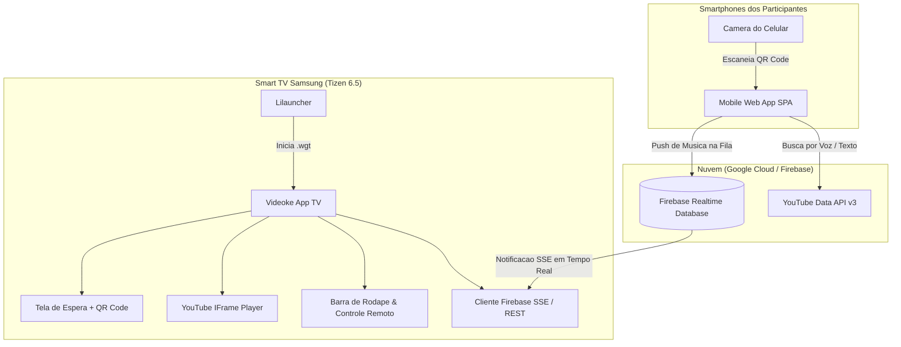
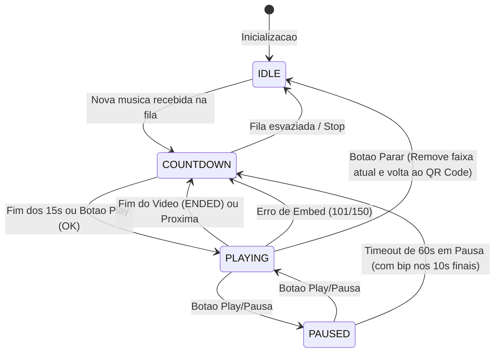

# Videoke Tizen Web App com Controle Mobile via QR Code

*   **Author:** mendes
*   **Status:** Approved
*   **Date:** 2026-10-30

--------------------------------------------------------------------------------

## Overview

O Videoke Tizen Web App e uma solucao integrada para a Smart TV Samsung (UN65BU8000, Tizen 6.5) empacotada como aplicativo nativo (.wgt) e acessivel diretamente pelo launcher da TV (lilauncher). A aplicacao transforma a televisao em uma estacao de videoke/karaoke autossuficiente com player em tela cheia, fila automatizada de reproducao e intervalo configurado de 15 segundos entre musicas para organizacao e troca de participantes.

A selecao e o envio de musicas sao realizados por smartphones individuais via leitura de um QR Code dinamico na tela da TV, sem necessidade de download ou instalacao de aplicativos por parte dos convidados. O celular executa uma aplicacao web leve que consulta o catalogo do YouTube atraves da YouTube Data API v3 (com busca textual e reconhecimento de voz), garantindo moderacao descentralizada (limite de 2 musicas ativas por participante) e sincronizacao bidirecional instantanea com a TV atraves do Firebase Realtime Database.

## The Problem

Em festas familiares e reunioes sociais, sistemas tradicionais de videoke costumam apresentar atritos significativos:
1. **Gargalo no controle fisico**: Um unico controle remoto compartilhado ou computador ligado a TV desacelera a escolha de faixas e gera disputas na fila.
2. **Barreira de entrada nos smartphones**: Convidar pessoas para baixar e instalar apps em lojas (Google Play / App Store) ou criar logins gera rejeicao imediata.
3. **Custo de hardware dedicado**: Aparelhos fisicos de videoke sao caros, possuem catalogos rigidos e exigem atualizacoes pagas de cartuchos ou discos.
4. **Dependencia de servidores locais**: Solucoes baseadas em streaming local exigem um PC de alta performance rodando na mesma rede para gerenciar o backend.
5. **Poluicao visual e de navegacao**: O uso direto da interface padrao do app do YouTube na TV perde o conceito de fila rotativa, nao oferece intervalo entre cantores e interrompe o ritmo com recomendacoes aleatorias.

A proposta resolve esses pontos com uma arquitetura dividida: a TV executa exclusivamente o player e a fila, enquanto os celulares dos convidados atuam como terminais independentes de selecao em tempo real conectados por um QR Code fixo.

## Goals

*   **Integracao ao Lilauncher**: Disponibilizar um pacote `.wgt` assinado com certificado Samsung (perfil `mendes`), compativel com Tizen 6.5 e integrado a grade de apps do launcher existente.
*   **Acesso Instantaneo por QR Code**: Exibir na tela da TV um QR Code com URL publica da aplicacao mobile, contendo o identificador fixo da sala (`room_id`), permitindo acesso direto sem instalacao ou criacao de contas.
*   **Busca Agil e Acessivel no Celular**: Permitir pesquisa por texto e por comando de voz (Web Speech API no Chrome Android) que consulte videos de videoke/karaoke gratuitos no YouTube.
*   **Sincronizacao em Tempo Real de Baixo Custo**: Manter a fila de reproducao sincronizada entre varios celulares e a TV utilizando o Firebase Realtime Database com comunicacao leve (REST / Server-Sent Events) no Chromium 85 da TV.
*   **Fila com Intervalo de Troca**: Tocar os videos em tela cheia sequencialmente, inserindo uma contagem regressiva de 15 segundos com aviso visual na tela entre o termino de uma musica e o inicio da proxima.
*   **Controles Essenciais na TV**: Barra de navegacao no rodape da TV sempre visivel nas telas de espera e contagem regressiva (e sob demanda durante o video), com botoes de reproducao (Play/Pause, Parar, Anterior, Proxima, Reset Fila, Sair), indicacao do titulo da proxima musica da fila e Mini QR Code flutuante no canto inferior esquerdo durante a reproducao dos videos.
*   **Politica Justa de Fila**: Limitar cada participante conectado pelo celular a no maximo 2 faixas pendentes simultaneas na fila, liberando novo envio apenas apos a reproducao de suas musicas.
*   **Resiliencia a Falhas de Embed**: Pular automaticamente para a proxima faixa caso o video escolhido falhe no carregamento ou possua restricao de incorporacao por direitos autorais (erros 101/150).

## Non-Goals

*   **Sincronizacao Customizada de Letras e MIDI**: O app nao faz parse de arquivos `.kar`, `.cdg`, `.lrc` nem extracao de faixas de audio; ele consome diretamente os videos ja sincronizados disponibilizados no YouTube.
*   **Burlar Anuncios por Codigo**: O aplicativo nao injeta scripts para bloquear ou pular propagandas dentro do sandbox de terceiro do YouTube IFrame. Para fechar anuncios pontuais, utiliza-se a interacao direta via mouse USB na TV.
*   **Pontuacao ou Analise Vocal**: Nao faz captura de microfone pela TV nem julgamento de afinacao/pontuacao ao fim da musica.
*   **Moderacao Avancada nos Smartphones**: Os celulares nao possuem permissao para deletar ou reordenar musicas adicionadas por outros participantes (essa gestao cabe unicamente a TV).
*   **Autenticacao Formal de Usuarios**: Nao havera criacao de contas com e-mail/senha; a identificacao do usuario e anonima e baseada em nome digitado e identificador unico gerado no navegador do celular.

## Open Questions

*   **Volume e Equalizacao**: A diferenca de volume entre diferentes canais do YouTube pode exigir ajuste manual do som na TV ou implementacao de normalizacao basica se a IFrame API permitir.
*   **Sobrecarga de Eventos SSE no Tizen 6.5**: O comportamento do streaming SSE com `EventSource` no Chromium 85 do Tizen durante reproducao prolongada precisa ser validado para garantir que nao ocorra vazamento de memoria em sessoes com mais de 3 horas continuas.

## Critical User Journeys (CUJs)

### CUJ 1: Entrada na Sala e Envio da Primeira Musica
*   **Given**: O app Videoke esta aberto na TV Samsung exibindo a tela de espera com o QR Code da sala `tv_sala_01`. O participante possui um smartphone com camera e navegador conectado a internet.
*   **When**: O participante aponta a camera para o QR Code na TV, clica no link aberto, digita seu nome ("Carlos"), fala ou digita o nome de uma musica ("Evidencias") e clica em "Enviar para fila" na versao escolhida.
*   **Then**: O Web app mobile confirma o envio e atualiza o contador do usuario para 1/2 musicas ativas. Na TV, o item entra imediatamente na fila do Firebase, fecha a tela de espera e inicia a reproducao do video em tela cheia.

### CUJ 2: Reproducao Continua com Intervalo de 15 Segundos
*   **Given**: A musica atual de Carlos esta terminando e ha mais duas musicas na fila (pedidas por Ana e Bruno).
*   **When**: O player do YouTube dispara o evento de termino do video (`onStateChange == YT.PlayerState.ENDED`).
*   **Then**: A TV exibe imediatamente a tela de transicao com contagem regressiva de 15 segundos, mostrando: "Proximo cantor: Ana - Como Nossos Pais". Ao zerar os 15 segundos (ou se alguem pressionar OK no controle remoto), o proximo video inicia automaticamente em tela cheia. A musica anterior e marcada como concluida, liberando 1 vaga no celular de Carlos.

### CUJ 3: Tratamento de Falha de Incorporacao do YouTube (Erros 101/150)
*   **Given**: Um participante adicionou uma musica cujo canal bloqueou a reproducao em sites ou apps terceiros.
*   **When**: O player tenta carregar o video na TV e a YouTube IFrame API emite o evento de erro 101 ou 150.
*   **Then**: A TV nao trava e nao tenta abrir aplicativos externos. Ela exibe um banner de notificacao de 3 segundos informando: "Este video nao permite incorporacao. Pulando para a proxima musica...", remove a faixa defeituosa e inicia a musica seguinte da fila sem interromper a sessao.

### CUJ 4: Bloqueio e Desbloqueio da Trava de 2 Musicas por Participante
*   **Given**: O participante Carlos ja enviou 2 musicas que ainda estao pendentes na fila da TV.
*   **When**: Carlos pesquisa uma 3ª musica e tenta clicar no botao "Enviar para fila".
*   **Then**: O botao no celular permanece desabilitado, exibindo a mensagem: "Limite atingido (2/2 musicas na fila). Aguarde uma de suas musicas tocar para pedir outra!". Assim que a TV conclui a primeira musica de Carlos, o web app mobile recebe a atualizacao via Firebase e reativa o botao.

### CUJ 5: Controle Direto via Controle Remoto da TV
*   **Given**: Um video esta sendo executado em tela cheia na TV.
*   **When**: O anfitriao aperta a tecla `ArrowDown` no controle remoto da TV.
*   **Then**: A barra de menu no rodape surge com animacao suave, exibindo os botoes de acao (Play/Pause, Stop, Pular, Sair) e o titulo da proxima musica. Ao selecionar "Proxima" e teclar `Enter`, o video atual e interrompido e a transicao para a proxima faixa inicia imediatamente. Se nenhuma tecla for pressionada por 5 segundos, a barra oculta-se automaticamente para nao cobrir a legenda da musica.

## Technical Plan (Architecture)

### 1. Visao Geral da Arquitetura e Fluxo de Dados

A solucao e dividida em tres camadas complementares:
1. **Frontend TV (Tizen Web App .wgt)**: Executa na TV Samsung, consome eventos do Firebase via HTTP SSE (streaming leve), renderiza o player IFrame do YouTube e escuta o controle remoto Samsung.
2. **Backend Serverless (Firebase Realtime Database)**: Armazena o estado da sala (`rooms/<room_id>`), atuando como intermediario rapido e sem custos entre celulares e a TV.
3. **Frontend Mobile (Web App Estatico)**: Hospedado em provedor estatico gratuito (Firebase Hosting ou GitHub Pages), consome a YouTube Data API v3 para busca e escreve comandos na fila do Firebase.



### 2. Modelo de Dados no Firebase Realtime Database

O schema e projetado para leitura rapida em arvore sem duplicacoes desnecessarias:

```json
{
  "rooms": {
    "tv_sala_01": {
      "meta": {
        "room_name": "Sala Principal",
        "created_at": 1730304000000,
        "is_active": true
      },
      "current": {
        "queue_id": "-OABC123xyz",
        "video_id": "9bZkp7q19f0",
        "title": "Chitaozinho e Xororo - Evidencias (Videoke)",
        "singer_name": "Carlos",
        "status": "playing",
        "started_at": 1730304050000
      },
      "queue": {
        "-OABC123xyz": {
          "video_id": "9bZkp7q19f0",
          "title": "Chitaozinho e Xororo - Evidencias (Videoke)",
          "thumbnail": "https://i.ytimg.com/vi/9bZkp7q19f0/default.jpg",
          "singer_name": "Carlos",
          "user_id": "usr_9988aabb",
          "status": "playing",
          "added_at": 1730304010000
        },
        "-OABC124uvw": {
          "video_id": "kJQP7kiw5Fk",
          "title": "Elis Regina - Como Nossos Pais (Karaoke)",
          "thumbnail": "https://i.ytimg.com/vi/kJQP7kiw5Fk/default.jpg",
          "singer_name": "Ana",
          "user_id": "usr_7766ccdd",
          "status": "pending",
          "added_at": 1730304020000
        }
      }
    }
  }
}
```

*   **Status de uma musica**: `pending` (aguardando na fila) e `playing` (em contagem regressiva de 15s ou reproducao atual no palco). Ao concluir, ser pulada ou interrompida com `Parar`, a musica e removida (`DELETE`) do Firebase para manter o banco limpo.
*   **Regra de cota e cancelamento no celular**: Cada participante pode ter no maximo 2 musicas ativas (`status == "pending" || status == "playing"`), nome limitado a 25 caracteres (`MAX_SINGER_NAME_LEN = 25`), e pode cancelar (`DELETE`) apenas suas proprias musicas cujo status ainda seja `pending`.

### 3. Maquina de Estados do Player na TV

O aplicativo da TV gerencia a exibicao atraves de uma maquina de estados finitos explicita para evitar condicoes de corrida durante eventos de rede:



1.  **IDLE (Espera)**: Fila vazia. O player do YouTube permanece oculto ou pausado. A tela exibe o fundo visual do videoke, o QR Code em destaque no centro, instrucoes de como conectar e a barra de rodape sempre visivel.
2.  **COUNTDOWN (Transicao de 15s em 2 Colunas)**: Sorteia 1 dos 13 wallpapers Full HD (`videoke-app/img/wallpapers/wp_01..13.jpg`), marca imediatamente a musica atual como `status: "playing"` no Firebase e divide a tela verticalmente em 2 colunas: à esquerda exibe o cantor/musica atual e o contador de 15s; à direita exibe a lista numerada (`1, 2, 3...`) das proximas musicas `pending` sem barra de rolagem. O botao `#btn-play-pause` recebe foco automatico exibindo `▶ Play` para permitir inicio imediato com um clique em `OK`.
3.  **PLAYING (Reproducao)**: O video do YouTube e carregado via bridge HTTPS (`yt-bridge.html`) em tela cheia (100vw, 100vh) para garantir cabeçalho `Origin`/`Referer` valido no Tizen. O botao `#btn-play-pause` muda para `❚❚ Pausa`. Um Mini QR Code permanece visivel no canto inferior esquerdo da tela para novos convidados conectarem durante a musica. A barra de controle oculta-se apos 5 segundos e reaparece ao tocar qualquer seta do controle remoto.
4.  **PAUSED (Pausa com Timeout de 60s)**: O video e pausado via `player.pauseVideo()` e o botao `#btn-play-pause` alterna para `▶ Play`. Um timer de 60 segundos e iniciado; nos ultimos 10 segundos exibe o banner `#pause-timeout-banner` com bip sonoro discreto via Web Audio API a cada segundo, avancando automaticamente para a proxima musica (ou voltando para `IDLE`) ao zerar.

### 4. Componentes da Aplicacao TV (Tizen Web App)

*   `videoke-app/config.xml`: Manifesto com id `lilvideoke.Videoke`, perfil `tv-samsung`, resolucao 1920x1080, e privilegios:
    *   `http://tizen.org/privilege/internet`
    *   `http://tizen.org/privilege/fullscreen`
    *   `http://tizen.org/privilege/tv.inputdevice`
    *   `http://tizen.org/privilege/tv.audio`
*   `videoke-app/index.html`: Estrutura HTML limpa:
    *   `#idle-screen`: Canvas/imagem com QR Code gerado localmente via script leve (`qrcode.min.js`) codificando a URL da sala.
    *   `#player-container`: Container `<div>` onde o `<iframe id="yt-bridge-frame">` carrega `https://videoke-tv.web.app/yt-bridge.html`.
    *   `#countdown-screen`: Overlay de transicao dividido em 2 colunas (`.countdown-left-col` e `.countdown-right-col`) sobre wallpaper aleatorio.
    *   `#pause-timeout-banner`: Alerta visual dos ultimos 10 segundos de pausa antes de avancar automaticamente.
    *   `#footer-bar`: Barra flutuante no rodape com botao unico alternavel `#btn-play-pause` (`▶ Play` / `❚❚ Pausa`), `Parar`, `Anterior`, `Proxima`, `Reset Fila` e `Sair`.
*   `videoke-app/js/app.js`: Controlador principal da aplicacao e maquina de estados.
*   `videoke-app/js/yt-player.js`: Controla o player embutido via `postMessage` para `yt-bridge.html` no Firebase Hosting.
*   `videoke-app/js/firebase-sync.js`: Conexao com o Firebase Realtime Database via `EventSource` (SSE), `PATCH` (`markPlaying`) e `DELETE` (`removeSong`, `clearQueue`).
*   `videoke-app/js/remote.js`: Mapeamento das teclas do Tizen (`MediaPlay`, `MediaPause`, `MediaStop`, `MediaFastForward`, `MediaRewind`, setas direcionais, `Enter` e `Back`).

### 5. Componentes da Aplicacao Mobile (Web SPA — v1.2 Alta Visibilidade 40+)

*   `videoke-mobile/index.html` e `videoke-mobile/css/mobile.css`: Layout responsivo em tema escuro de alto contraste com tipografia ampliada para leitura confortavel sem oculos (40+): titulo `"Videokê TV"` (`26px`) com icone de microfone (`36px`), rotulos (`16px`), campos de digitacao de nome e busca (`20px`) com o botao de voz e `"Buscar"` alinhados na mesma linha horizontal, tela dedicada `"Ver Fila"` (`#queue-view`) e resultados de busca ocultos ate a primeira pesquisa real.
*   `videoke-mobile/js/app.js`:
    *   Recupera o `room_id` da URL (`window.location.search`).
    *   Gera e armazena UUID fixo em `localStorage.getItem("karaoke_user_id")`.
    *   Limita o nome do cantor a 25 caracteres (`MAX_SINGER_NAME_LEN = 25`).
    *   Renderiza nos resultados de busca um botao estreito (`48x54px`) apenas com icone de seta para cima (`↑` / `&#8593;`), que muda para `✓` (`&#10003;`) verde quando a musica esta ativa na fila do participante.
    *   Permite visualizar a fila completa (`#queue-view`) destacando as musicas do proprio participante e cancelar (`DELETE`) apenas suas proprias musicas com status `pending`.
*   `videoke-mobile/js/speech.js`: Integracao com a Web Speech API (`webkitSpeechRecognition`).
*   `videoke-mobile/js/youtube.js`: Consulta a YouTube Data API v3 (`maxResults=8`, `videoEmbeddable=true`) com cache em memoria, sem exibir sugestoes ilustrativas pre-carregadas.

## Alternatives Considered

### Alternative A: Proxies Comunitarios do YouTube (Invidious e Piped)

*   **Pros**: Sem consumo da cota oficial da API v3 do YouTube (sem limite de 100 buscas/dia); dispensa geracao e configuracao de chave de API pelo desenvolvedor; possibilidade teorica de extrair fluxos diretos sem anuncios.
*   **Cons**: Instabilidade severa e imprevisivel; servidores publicos sofrem bloqueios constantes de IP pelo Google (erros HTTP 429); instancias gratuitas saem do ar com frequencia e sem aviso.
*   **Reason for Rejection**: Incompativel com um sistema que precisa funcionar de forma confiavel durante encontros sociais. Evitar a queda no meio de um evento exigiria a manutencao e o custo de uma VPS propria executando proxy customizado.

### Alternative B: Chaveamento Externo via Deep Link para o App Nativo do YouTube

*   **Pros**: Permite reproduzir videos cuja incorporacao externa foi restrita pelo proprietario dos direitos autorais (erros 101 e 150 no IFrame).
*   **Cons**: No Tizen 6.5, ao disparar um app externo, o app de videoke e jogado para segundo plano. Ao concluir o video, o app do YouTube permanece aberto tocando recomendacoes aleatorias e nao devolve o controle ao videoke. O sistema Tizen de varejo nao concede privilegios de parceiro para forcar a volta do app em primeiro plano.
*   **Reason for Rejection**: Quebra completamente o fluxo automatizado da fila e a transicao entre cantores, obrigando o anfitriao a intervir manualmente com o controle da TV a cada video bloqueado. O tratamento interno (notificar o bloqueio e pular para a proxima musica) mantem o evento fluido.

### Alternative C: Servidor Local Node.js no PC com WebSockets

*   **Pros**: Latencia minima de comunicacao na rede local; ausencia de limites de banco de dados em nuvem; controle total sobre os dados e conexoes.
*   **Cons**: Exige manter um computador ligado na mesma rede Wi-Fi com o servico Node.js rodando sempre que a TV for utilizada.
*   **Reason for Rejection**: Fere o principio de autonomia da Smart TV. O aplicativo de videoke deve funcionar diretamente pelo controle remoto e conexao de internet da TV, sem necessidade de ligar ou configurar um computador de apoio.

### Alternative D: SDK Modular Oficial do Firebase (v9/v10) na TV

*   **Pros**: Gerenciamento de reconexao e tipagens oficiais fornecidas pela Google.
*   **Cons**: Bundle JavaScript pesado e complexo, com impacto negativo no motor Chromium 85 em processador ARMv7 de 32 bits com recursos limitados.
*   **Reason for Rejection**: A comunicacao nativa via Server-Sent Events (`EventSource`) da API REST do Firebase Realtime Database atende plenamente o recebimento de atualizacoes da fila em tempo real, com consumo desprezivel de memoria e sem dependencias externas no pacote `.wgt`.

## Detailed Implementation

Esta secao descreve o plano unificado de construcao da solucao, enumerando todos os arquivos criados e modificados, suas responsabilidades e a justificativa tecnica de cada alteracao.

### 1. Lista Unificada de Arquivos

#### A. Aplicativo da TV Samsung Tizen (.wgt) em `videoke-app/`

1.  [`videoke-app/config.xml`](file:///c:/Users/mende/Projetos/tv/videoke-app/config.xml)
    *   **Acao**: Criar arquivo.
    *   **Justificativa**: Manifesto obrigatorio do Tizen Studio com identificador alfanumerico seguro sem espacos (`lilvideoke.Videoke`), definicao de resolucao nativa 1920x1080, permissao de tela cheia, privilegios de rede (`internet`), controle remoto (`tv.inputdevice`), saida de som (`tv.audio`) e politica de permissao de origem irrestrita para comunicacao com Firebase e carregamento do IFrame do YouTube (`<access origin="*" subdomains="true"/>`).

2.  [`videoke-app/icon.png`](file:///c:/Users/mende/Projetos/tv/videoke-app/icon.png)
    *   **Acao**: Criar arquivo (resolucao 117x117 ou 512x512).
    *   **Justificativa**: Icone representativo do aplicativo de videoke para exibicao no Smart Hub da TV e na grade do lilauncher.

3.  [`videoke-app/index.html`](file:///c:/Users/mende/Projetos/tv/videoke-app/index.html)
    *   **Acao**: Criar arquivo.
    *   **Justificativa**: Ponto de entrada do web app na TV. Contem a estrutura semantica em camadas: container do player em tela cheia (`#player`), camada de transicao com contagem regressiva de 15s (`#countdown-screen`), camada de espera com o QR Code para pareamento (`#idle-screen`) e barra de navegacao flutuante no rodape (`#footer-bar`).

4.  [`videoke-app/css/style.css`](file:///c:/Users/mende/Projetos/tv/videoke-app/css/style.css)
    *   **Acao**: Criar arquivo.
    *   **Justificativa**: Estilos especificos para televisores 1080p, contraste aprimorado, animacoes por aceleracao de hardware (`transform`/`opacity` sem reflow), vinheta de tela, layout do QR Code de alta legibilidade a distancia e estilizacao visual dos estados de foco da barra de menu.

5.  [`videoke-app/js/qrcode.min.js`](file:///c:/Users/mende/Projetos/tv/videoke-app/js/qrcode.min.js)
    *   **Acao**: Criar arquivo.
    *   **Justificativa**: Biblioteca estatica ultra-leve para geracao dinamica do QR Code diretamente em elemento `<canvas>` ou SVG no navegador da TV, eliminando qualquer dependencia de APIs externas de geracao de QR Code.

6.  [`videoke-app/js/yt-player.js`](file:///c:/Users/mende/Projetos/tv/videoke-app/js/yt-player.js)
    *   **Acao**: Criar arquivo.
    *   **Justificativa**: Modulo que carrega a YouTube IFrame API (`https://www.youtube.com/iframe_api`), instancia o player com parametros de tela cheia sem controles nativos (`controls: 0`, `autoplay: 1`), expoe metodos de controle (`play`, `pause`, `stop`, `loadVideo`) e despacha eventos de conclusao de faixa (`ENDED`) e erros de restricao de direitos autorais (`101` e `150`).

7.  [`videoke-app/js/firebase-sync.js`](file:///c:/Users/mende/Projetos/tv/videoke-app/js/firebase-sync.js)
    *   **Acao**: Criar arquivo.
    *   **Justificativa**: Modulo responsavel por abrir e gerenciar a conexao de streaming nativo via `EventSource` no endpoint SSE do Firebase (`/rooms/<room_id>/queue.json`). Emite atualizacoes da fila para o app e executa chamadas HTTP `PATCH` leves para atualizar o status das musicas para `playing`, `completed` ou `skipped`.

8.  [`videoke-app/js/remote.js`](file:///c:/Users/mende/Projetos/tv/videoke-app/js/remote.js)
    *   **Acao**: Criar arquivo.
    *   **Justificativa**: Registra os codigos de teclas do controle remoto da TV Samsung atraves da API `tizen.tvinputdevice.registerKey` (`MediaPlay`, `MediaPause`, `MediaStop`, `MediaFastForward`, `MediaRewind`) e processa eventos de teclado (`keydown`) para as setas direcionais, OK/Enter (para iniciar imediatamente sem esperar os 15s) e Voltar/Sair.

9.  [`videoke-app/js/app.js`](file:///c:/Users/mende/Projetos/tv/videoke-app/js/app.js)
    *   **Acao**: Criar arquivo.
    *   **Justificativa**: Nucleo da aplicacao na TV que implementa a maquina de estados (IDLE, COUNTDOWN, PLAYING, PAUSED), orquestra o timer de 15 segundos entre faixas, coordena a exibicao da barra de rodape e conecta os eventos do Firebase com os comandos do player de video.

#### B. Aplicacao Mobile (Web SPA) em `videoke-mobile/`

10. [`videoke-mobile/index.html`](file:///c:/Users/mende/Projetos/tv/videoke-mobile/index.html)
    *   **Acao**: Criar arquivo.
    *   **Justificativa**: Estrutura responsiva mobile-first para navegadores de smartphones. Contem cabecalho com identificador da sala conectada, campo de identificacao do cantor ("Seu nome"), barra de pesquisa com botoes de texto e microfone, lista dinamica de resultados com botao "Enviar para fila" e contador visual de cota ("Suas musicas: X de 2 na fila").

11. [`videoke-mobile/css/mobile.css`](file:///c:/Users/mende/Projetos/tv/videoke-mobile/css/mobile.css)
    *   **Acao**: Criar arquivo.
    *   **Justificativa**: Estilizacao moderna com tema escuro (Dark Mode) adaptada para telas sensiveis ao toque, alto contraste, botoes acessiveis para dedos e feedback tatil/visual ao clicar e enviar musicas.

12. [`videoke-mobile/js/speech.js`](file:///c:/Users/mende/Projetos/tv/videoke-mobile/js/speech.js)
    *   **Acao**: Criar arquivo.
    *   **Justificativa**: Integracao com a Web Speech API (`webkitSpeechRecognition` no Chrome do Android). Trata ativacao do microfone, transcricao de voz em tempo real e preenchimento automatico do campo de busca com acionamento da pesquisa ao pausar a fala.

13. [`videoke-mobile/js/youtube.js`](file:///c:/Users/mende/Projetos/tv/videoke-mobile/js/youtube.js)
    *   **Acao**: Criar arquivo.
    *   **Justificativa**: Camada de comunicacao com a YouTube Data API v3 (`https://www.googleapis.com/youtube/v3/search`). Anexa automaticamente os modificadores de busca `videoke karaoke`, limita os resultados a 8 itens relevantes, extrai titulos, IDs e miniaturas, e mantem cache em memoria para economizar unidades de cota diaria.

14. [`videoke-mobile/js/app.js`](file:///c:/Users/mende/Projetos/tv/videoke-mobile/js/app.js) e [`videoke-mobile/yt-bridge.html`](file:///c:/Users/mende/Projetos/tv/videoke-mobile/yt-bridge.html)
    *   **Acao**: Criar arquivos.
    *   **Justificativa**: `app.js` atua como orquestrador mobile que extrai o parametro `?room=<tv_id>` da URL aberta pelo QR Code, gera ou le o UUID unico do aparelho em `localStorage`, monitora a fila do Firebase para calcular em tempo real a quantidade de musicas ativas do participante e efetua a gravacao de novos pedidos de musica via HTTP POST no Firebase. `yt-bridge.html` fornece a ponte HTTPS no Firebase Hosting para embutir o player do YouTube na TV com cabecalhos `Origin` e `Referer` validos via `postMessage`.

#### C. Scripts de Automacao, Empacotamento e Integracao ao Launcher

15. [`scripts/06-instalar-videoke.ps1`](file:///c:/Users/mende/Projetos/tv/scripts/06-instalar-videoke.ps1) e [`scripts/06-instalar-videoke.bat`](file:///c:/Users/mende/Projetos/tv/scripts/06-instalar-videoke.bat)
    *   **Acao**: Criar arquivos.
    *   **Justificativa**: Script padronizado seguindo a esteira de build do projeto: conecta ao SDB na TV (`192.168.18.77:26101`), compila o projeto `videoke-app` via `tizen build-web`, empacota e assina com o perfil de certificado `mendes` (`tizen package -t wgt -s mendes`), instala o pacote `Videoke.wgt` na TV e executa o app com o ID `lilvideoke.Videoke`.

16. [`launcher/src/js/data/shelf.js`](file:///c:/Users/mende/Projetos/tv/launcher/src/js/data/shelf.js) e [`videoke-app/js/config.js`](file:///c:/Users/mende/Projetos/tv/videoke-app/js/config.js)
    *   **Acao**: Modificar arquivo existente (`shelf.js`) e criar arquivo de configuracao (`config.js`).
    *   **Justificativa**: Adicionar o card de atalho "Videokê" na lista de aplicativos curados da interface principal do lilauncher (`window.SHELF`), apontando para o app ID `lilvideoke.Videoke`, com icone dedicado (`img/logos/videoke.jpg`), e centralizar parametros de sala/Firebase/timer em `config.js`.

---

### 2. Especificacao das Interfaces de Comunicacao

#### A. Contrato de Envio Mobile -> Firebase (REST POST)
*   **Endpoint**: `POST https://<PROJETO>.firebaseio.com/rooms/<ROOM_ID>/queue.json`
*   **Payload**:
    ```json
    {
      "video_id": "string (11 caracteres do YouTube)",
      "title": "string (Titulo formatado da faixa)",
      "thumbnail": "string (URL da imagem de capa)",
      "singer_name": "string (Nome digitado pelo usuario)",
      "user_id": "string (UUID gerado no localStorage do celular)",
      "status": "pending",
      "added_at": 1730304000000
    }
    ```

#### B. Contrato de Consumo TV -> Firebase (Server-Sent Events)
*   **Conexao**: `new EventSource("https://<PROJETO>.firebaseio.com/rooms/<ROOM_ID>/queue.json")`
*   **Tratamento de Eventos**:
    *   Ao conectar: evento `put` entrega a arvore completa da fila.
    *   Ao adicionar nova musica: evento `put` ou `patch` com o no especifico recem-criado.
    *   A TV processa a lista, filtra itens com status `pending` ordenados por `added_at` ascendente e transiciona o player para reproducao se a fila estava vazia.

#### C. Atualizacao de Estado TV -> Firebase (REST PATCH)
*   Ao iniciar uma faixa: `PATCH /rooms/<ROOM_ID>/queue/<KEY>.json` com `{ "status": "playing" }` e atualizacao de `/rooms/<ROOM_ID>/current.json`.
*   Ao concluir uma faixa: `PATCH /rooms/<ROOM_ID>/queue/<KEY>.json` com `{ "status": "completed", "completed_at": Date.now() }`.
*   Ao pular uma faixa por erro de embed ou comando manual: `PATCH /rooms/<ROOM_ID>/queue/<KEY>.json` com `{ "status": "skipped", "skipped_reason": "error_150" }`.

---

### 3. Fases de Execucao da Implementacao

1.  **Fase 1: Aplicativo TV (Estrutura e Player Offline)**
    *   Criar esqueleto em `videoke-app/` com manifesto `config.xml` e estilizacao basica.
    *   Implementar `yt-player.js` e validar a execucao do IFrame com tela cheia, sem controles nativos e captura de eventos de termino.
    *   Implementar a tela de contagem regressiva de 15s e a barra de rodape com atalhos de controle remoto.
2.  **Fase 2: Sincronizacao em Tempo Real com Firebase**
    *   Criar modulo `firebase-sync.js` na TV consumindo o stream SSE.
    *   Validar atualizacao automatica da fila na TV ao injetar dados simulados no Firebase.
    *   Implementar geracao do QR Code dinamico na tela inicial apontando para o identificador da sala.
3.  **Fase 3: Aplicacao Web Mobile**
    *   Desenvolver `videoke-mobile/` com layout responsivo e leitura da sala via query param.
    *   Integrar consulta a YouTube Data API v3 com debounce e cache.
    *   Implementar ativacao de microfone via Web Speech API.
    *   Implementar a trava de 2 musicas ativas vinculada ao UUID em `localStorage` e persistencia no Firebase.
4.  **Fase 4: Empacotamento, Integracao e Validacao na TV**
    *   Criar scripts `06-instalar-videoke.ps1` e `06-instalar-videoke.bat`.
    *   Compilar o pacote `Videoke.wgt` assinado com perfil `mendes` e instalar na TV via SDB.
    *   Inserir o atalho do Videoke na grade do `lilauncher` (imagem: `C:\Users\mende\Projetos\tv\logos\videoke.jpg`).
    *   Realizar teste de ponta a ponta: leitura do QR Code pelo celular, envio de musica por voz e reproducao sequencial na TV Samsung.
